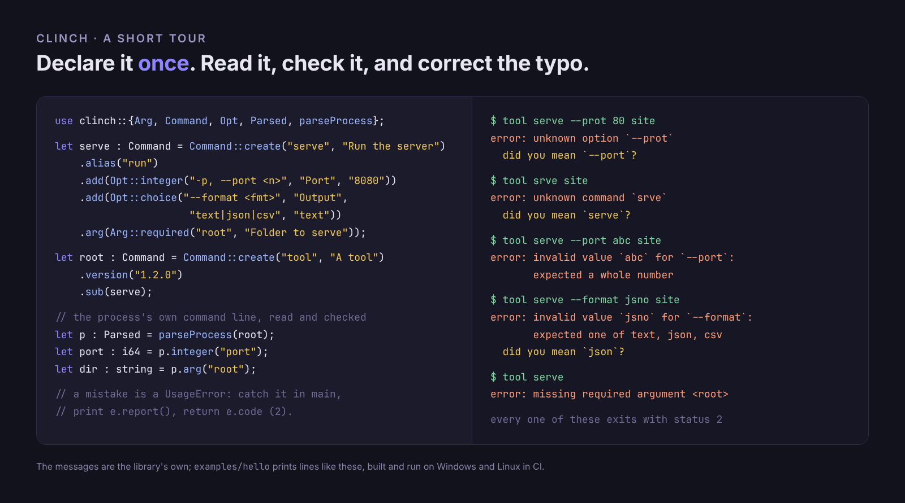
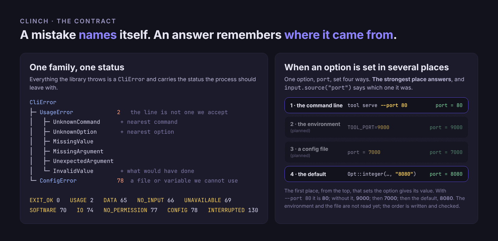

<div align="center">

# 🔩 clinch

### The command line of an [**Axle**](https://axle-lang.dev) program — commands, options, arguments, values and mistakes — declared once

**Not a hand-rolled argv loop.** Every program that takes arguments ends up writing the same `while (i < argc())`, an "unknown option" that guesses nothing, and an exit code that means whatever the author felt that day. Clinch is that layer, once: a declaration written the way the command is typed, a parser that checks every value against what it declared, mistakes that name themselves and point at the word you meant, and a status the shell can rely on.

<p align="center">
  <a href="https://axle-lang.dev"></a>
  <a href="https://github.com/Axle-lang/gesso"></a>
</p>
<p align="center">
  
  
  
</p>



<sub>The messages are the library's own; <code>examples/hello</code> prints lines like these, built and run on Windows and Linux in CI.</sub>

<br>

<sub><a href="#-at-a-glance">At a glance</a> · <a href="#-quick-start">Quick start</a> · <a href="#-what-it-reads">What it reads</a> · <a href="#-the-contract">Contract</a> · <a href="#-whats-in-the-box">What's in the box</a> · <a href="doc/ROADMAP.md">Roadmap</a> · <a href="https://axle-lang.dev">Axle ↗</a></sub>

</div>

---

> **clinch** *(v.)* — to drive a nail through and bend its point back on the far side, so that it cannot
> pull out; and so, to settle a matter for good.
> [smalt](https://github.com/Axle-lang/smalt), [zaffre](https://github.com/Axle-lang/zaffre) and
> [gesso](https://github.com/Axle-lang/gesso) are what a painter works with; clinch is the nail — what fastens
> the arguments of a program to the one place that says what they are.

> **Status.** The declaration, the parser, the suggestions and the errors are written and checked. `--help`,
> configuration files, environment variables, completion scripts, JSON/CSV output, prompts and signal handling
> are not: see the [roadmap](doc/ROADMAP.md).

## 📊 At a glance

| | |
|---|---|
| **Language** | 100% [Axle](https://axle-lang.dev), on `std` alone — no C, no dependency |
| **Platforms** | Windows and Linux, one source tree. Nothing here touches the operating system but the process's own arguments, through `std` |
| **Declaration** | A `Command` is a name, options, positional arguments and subcommands. An option is declared **the way it is typed**: `-p, --port <n>` is a short name, a long name and a value |
| **Reading** | `--port 80`, `--port=80`, `-p 80`, `-p80`, clusters (`-vqp 80`), repeated options, subcommands and their aliases, `--`, a lone `-`; a parent's options work before *and* after the subcommand |
| **Values** | Checked against the kind the option declared — whole number, number, text, path, one of a set of words — and refused with what was expected |
| **Mistakes** | A `UsageError` carries the status to leave with, and is one of six reasons. When the word is a near miss of a real one it says so: ``did you mean `--port`?`` |
| **Provenance** | Every answer remembers whether it came from the command line, the environment, a file or the default; a lower source never replaces a higher one |
| **Statuses** | `EXIT_USAGE` is 2, `EXIT_CONFIG` 78, `EXIT_INTERRUPTED` 130, and the rest of `sysexits.h`, as `pub const`s: `return EXIT_USAGE;` is all a `main` writes |

## 🚀 Quick start

```toml
# your-program/axle.toml
[package]
name = "your-program"

[dependencies]
clinch = { path = "../clinch" }
```

```rs
use clinch::{Arg, Command, Opt, Parsed, UsageError, parseProcess};

fn spec() : Command {
    let serve : Command = Command::create("serve", "Pretend to serve a folder")
        .alias("run")
        .add(Opt::integer("-p, --port <n>", "Port to listen on", "8080"))
        .arg(Arg::required("root", "Folder to serve"));
    return Command::create("hello", "A tiny server that serves nothing")
        .version("0.1.0")
        .add(Opt::flag("-v, --verbose", "Say more"))
        .sub(serve);
}

fn main() : i32 {
    try {
        let parsed : Parsed = parseProcess(spec());     // the process's own command line
        if (parsed.versionAsked) {
            println(parsed.versionLine());              // hello 0.1.0
            return 0;
        }
        println(parsed.path() + ": serving " + parsed.arg("root") + " on " + parsed.text("port"));
        return 0;
    } catch e : UsageError {
        println(e.report());            // the message, and under it "did you mean …?" when one is near
        return e.code;                  // 2: the shell can tell a mistake from a failure
    }
}
```

```text
$ hello serve --port 9000 site
hello serve: serving site on 9000
$ hello serve --prot 1 site
error: unknown option `--prot`
  did you mean `--port`?
$ echo $?
2
```

`parseProcess(root)` reads the process's own command line. `parseLine(root, words)` is the same read over an
`ArrayList<string>` you hand it — a test, a line typed in a prompt. `readProcess` and `readLine` stop before the
defaults are added, so the environment and a file can be offered first.

## 🔎 What it reads

| Form | Example | Read as |
|---|---|---|
| long option | `--port 80`, `--port=80` | `parsed.integer("port")` is 80 |
| short option | `-p 80`, `-p80` | the same option |
| cluster of flags | `-vq`, `-vqp 80` | letters read left to right until one takes a value |
| repeated option | `-I a -I b` | `parsed.all("include")` is `a`, `b` |
| subcommand and alias | `serve`, `run` | `parsed.path()` is `tool serve` either way |
| negative number | `-p -5` | a value, not an option |
| end of options | `-- -weird` | everything after is positional |
| lone dash | `-` | a positional (stdin, by convention) |
| switched-off flag | `--quiet=false` | `parsed.flag("quiet")` is false |
| help and version | `-h`, `--help`, `-V`, `--version` | `parsed.helpAsked`, `parsed.versionAsked` — reading stops |

Values are read with `text`, `integer`, `number` and `flag`; positionals with `arg("name")`, `rest("name")` and
`count()`; where an answer came from with `source("name")`.

## 📜 The contract

A mistake names itself, carries the status to leave with, and says what was meant when it can tell. An answer
remembers where it came from, so *"why is this 4?"* has an answer.

<div align="center"></div>

The environment and the file are the levels still to be read; the order they will feed — and the rule that a
lower source never replaces a higher one — is written and checked (`Parsed::offer`).

## 📦 What's in the box

| | |
|---|---|
| `src/spec.axle` | `Command`, `Opt`, `Arg`, `Kind` — the declaration |
| `src/parse.axle` | `Parsed`, `Source`, `parseLine`, `readLine` |
| `src/args.axle` | `parseProcess`, `readProcess`, `processWords` — the process's own command line |
| `src/error.axle` | `CliError`, `UsageError` and its six reasons, the `EXIT_*` statuses |
| `src/suggest.axle` | `editDistance`, `nearestWord` — the "did you mean" |
| `src/text.axle`, `src/list.axle` | small helpers `std` does not give: a slice that cannot throw, number parsers that answer yes or no, sequences for structs and classes held in a field |
| `examples/hello` | the smallest program with a command line worth the name |
| `tests` | the checks: `cd tests && axle build && ./target/tests` |

## License

MIT.
