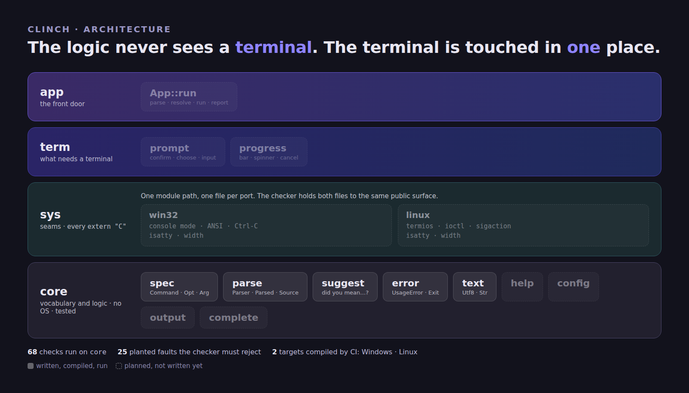

<div align="center">

# 🔩 clinch

### The command line of an [**Axle**](https://axle-lang.dev) program — commands, options, arguments, values and mistakes — as **one description** that everything else reads

**Not a hand-rolled argv loop.** Every program that takes arguments ends up writing the same `while (i < argc())`, the same `--snap` check, an "unknown option" that guesses nothing, and an exit code that means whatever the author felt that day. Clinch is that layer, once: a declaration written the way the command is typed, a parser that checks every value against what it declared, mistakes that name themselves and point at the word you meant, and a status the shell can rely on.

<p align="center">
  <a href="https://axle-lang.dev"></a>
  <a href="https://github.com/Axle-lang/gesso"></a>
</p>
<p align="center">
  
  
  
  
  
  
</p>


<sub>Every message in the right-hand column is printed by the library's own sources — and by <code>examples/hello</code>, which CI builds and runs on Windows and Linux.</sub>

<br>

<sub><a href="#-at-a-glance">At a glance</a> · <a href="#-highlights">Highlights</a> · <a href="#-quick-start">Quick start</a> · <a href="#-what-it-reads">What it reads</a> · <a href="#-the-modules">Modules</a> · <a href="#-the-contract">Contract</a> · <a href="#-honest-status">Status</a> · <a href="doc/ARCHITECTURE.md">Architecture</a> · <a href="doc/ROADMAP.md">Roadmap</a> · <a href="LIMITATIONS.md">Limitations</a> · <a href="https://axle-lang.dev">Axle ↗</a></sub>

</div>

---

> **clinch** *(v.)* — to drive a nail through and bend its point back on the far side, so that it cannot
> pull out; and so, to settle a matter for good.
> That is the whole library. [smalt](https://github.com/Axle-lang/smalt), [zaffre](https://github.com/Axle-lang/zaffre)
> and [gesso](https://github.com/Axle-lang/gesso) are what a painter works with; clinch is the nail — what fastens
> the arguments of a program to the one place that says what they are.

> **Status.** The first slice is written, compiled and run: the declaration, the parser, the suggestions,
> the errors and the statuses — 68 checks over the translated sources, and `examples/hello` built and run by
> CI on Windows and Linux with the real compiler. **`--help`, configuration files, environment variables,
> completion scripts, JSON/CSV output, prompts, progress and signal handling are not written yet**; the
> [roadmap](doc/ROADMAP.md) says in which order, and [`LIMITATIONS.md`](LIMITATIONS.md) says what is proven and
> what is only checked.

## 📊 At a glance

| | |
|---|---|
| **Language** | 100% [Axle](https://axle-lang.dev) — no C, no vendored library, no `[link]` section |
| **Platforms** | Windows x86-64 and Linux x86-64 — one source tree. Everything written so far is portable and touches no operating system; the terminal and the signals, when they arrive, will sit behind per-port seams in `src/sys/`, as in [gesso](https://github.com/Axle-lang/gesso) |
| **Declaration** | A `Command` is a name, options, positional arguments and subcommands. An option is declared **the way it is typed** — `-p, --port <n>` is a short name, a long name and a value — and its kind (`integer`, `number`, `path`, `text`, `choice`, a flag, a repeatable one) is the kind its value is checked against |
| **Reading** | `--port 80`, `--port=80`, `-p 80`, `-p80`, clusters (`-vqp 80`), repeated options, subcommands and their aliases, `--`, a lone `-`; the options of a parent work before *and* after the subcommand |
| **Mistakes** | Every refusal is a `UsageError` — a `CliError` carrying the **status the process should leave with** — and one of six reasons: `UnknownCommand`, `UnknownOption`, `MissingValue`, `MissingArgument`, `UnexpectedArgument`, `InvalidValue`. When the word is a near miss of a real one it says so: ``did you mean `--port`?`` |
| **Provenance** | Every answer remembers where it came from — the command line, the environment, a file, or the declared default — and a lower source never replaces a higher one: `parsed.source("port")` |
| **Statuses** | `Exit::usage()` is 2, `config()` is 78, `interrupted()` is 130, and the rest of `sysexits.h` is named, so a program leaves with a number a shell script can read |
| **Strings** | Read as bytes: an argument holding any language passes through unchanged, and codepoints are decoded only where a screen's width needs them |
| **Verification** | The portable logic is translated to Python and run — 68 checks — beside a checker for layers and seams that plants 25 faults and fails if any is accepted; the real compiler builds and runs the example in CI |
| **Known limits** | All of them, with what each would take to lift: [`LIMITATIONS.md`](LIMITATIONS.md) |

## ✨ Highlights

- 🧾 **Declared the way it is typed** — `Opt::integer("-p, --port <n>", "Port to listen on", "8080")` says the short name, the long name, the value's name, its kind, the sentence for `--help` and the default, in the order a person reads a usage line. There is no second place to keep in step.
- 🔗 **One expression per command** — `Command::create(...)` starts a chain that `alias`, `add`, `arg`, `sub`, `version` and `example` continue, each returning the command. The chain starts at a `static fn` on purpose: the compiler reads `new Command(…).add(…)` as a statement, and the library never asks for it.
- ✅ **A value is checked against what it declared** — `--port abc` is ``invalid value `abc` for `--port`: expected a whole number``, not a zero read in silence three calls later. A `choice` knows its words and says them: `expected one of text, json, csv`.
- 💡 **"Did you mean…?" that is right or silent** — the nearest word by edit distance, a swap of two neighbours counting as **one** slip (the commonest of the fingers: `sevre` → `serve`), case ignored. The reach is a third of what was typed, never under one, and past it nothing is suggested: a wrong suggestion is worse than none.
- 🧭 **Where an option may appear** — an option of the parent is read before or after the subcommand; one of a *sibling* is unknown here, and says so. `--help` stops the reading and **names the command it was asked of**, so `tool serve --help` is about `serve` even when its required argument is missing.
- ✂️ **The corner cases a shell script meets** — `-p -5` is a negative number and not an option, `-` is a positional (stdin, by convention), `--` ends the options, `--flag=false` switches a flag off, `-I a -I b -Ic` keeps all three values.
- 🏷️ **An answer remembers its source** — `Default < Config < Env < Argv`, and `Parsed::offer` keeps only what outranks what is there. The readers for the environment and a file are the next slices; the order they will feed is already implemented and tested.
- 🚦 **A failure is a status** — `CliError` carries `code`, so `catch e : UsageError { return e.code; }` is the whole of error handling in a `main`. 2 for a mistake of the person typing, 78 for a configuration that cannot be used, 130 for Ctrl-C: the numbers a shell expects.
- 🧪 **A checker, because the compiler is not in the loop of every edit** — a parser written from the language's documentation, a resolver for names and arities, the layer rules, a 110-column rule, and a self-test that plants 25 faults and fails if any is accepted.

## 🚀 Quick start

```toml
# your-program/axle.toml
[package]
name = "your-program"

[dependencies]
clinch = { path = "../clinch" }
```

```rs
use clinch::{Arg, Command, Opt, Parsed, Parser, UsageError, Values};
use std::sys::process::{argAt, argc};

fn spec() : Command {
    let serve : Command = Command::create("serve", "Pretend to serve a folder")
        .alias("run")
        .add(Opt::integer("-p, --port <n>", "Port to listen on", "8080"))
        .arg(Arg::required("root", "Folder to serve"));
    return Command::create("hello", "A tiny server that serves nothing")
        .version("0.1.0")
        .add(Opt::flag("-v, --verbose", "Say more"))
        .sub(serve);
}

/** The words after the program's name. */
fn words() : Values<string> {
    let out : Values<string> = new Values<string>();
    for (i of 1..argc()) {
        try {
            out.add(argAt(i));
        } catch e : IndexOutOfBoundsException {
            break;
        }
    }
    return out;
}

// `main` is the only place errors stop: every call above says what it can raise.
fn main() : i32 {
    try {
        let parsed : Parsed = Parser::parse(spec(), words());
        println(parsed.path() + ": serving " + parsed.arg("root") + " on " + parsed.text("port"));
        return 0;
    } catch e : UsageError {
        println("error: " + e.message);
        if (e.hint != "") {
            println("  " + e.hint);
        }
        return e.code;                  // 2: the shell can tell a mistake from a failure
    }
}
```

That is `examples/hello` — less its two lines that answer `--help` and `--version` — which CI builds and runs on both systems:

```text
$ hello serve --port 9000 site
hello serve: serving site on 9000
$ hello serve --prot 1 site
error: unknown option `--prot`
  did you mean `--port`?
$ echo $?
2
```

```bash
cd examples/hello
axle build && ./target/hello serve --port 9000 site
```

## 🔎 What it reads

| Form | Example | Read as |
|---|---|---|
| long option | `--port 80`, `--port=80` | `parsed.integer("port")` is 80 |
| short option | `-p 80`, `-p80` | the same option |
| cluster of flags | `-vq`, `-vqp 80` | letters read left to right until one takes a value |
| repeated option | `-I a -I b` | `parsed.all("include")` is `a`, `b` |
| subcommand and alias | `serve`, `run` | `parsed.path()` is `tool serve` either way |
| negative number | `-p -5` | a value, not an option |
| end of options | `-- -weird` | everything after is positional |
| lone dash | `-` | a positional (stdin, by convention) |
| switched-off flag | `--quiet=false` | `parsed.flag("quiet")` is false |
| help and version | `-h`, `--help`, `-V`, `--version` | `parsed.helpAsked`, `parsed.versionAsked` — reading stops |

Values are read with `text`, `integer`, `number` and `flag`; positionals with `arg("name")`, `rest("name")` and
`count()`; the source of an answer with `source("name")`.

## 🧩 The modules

| Module | For | Status |
|---|---|---|
| `core::text` | UTF-8 cuts, searches, `Str::toInt`, `Str::toFloat`, `Str::copy` | written, compiled, **run** |
| `core::error` | `CliError` → `UsageError` → six reasons, `ConfigError`, `Exit` statuses | written, compiled, **run** |
| `core::spec` | `Command`, `Opt`, `Arg`, `Kind` — the declaration | written, compiled, **run** |
| `core::suggest` | edit distance, `Suggest::nearest` | written, compiled, **run** |
| `core::parse` | `Parser`, `Parsed`, `Source` | written, compiled, **run** |
| `core::help` | `--help` and `--version` generated from the declaration, wrapped to the terminal's width | next slice |
| `core::config` | a TOML subset and JSON, `APP_*` environment variables, the four-level order, `--explain-config` | planned |
| `core::output` | text, JSON and CSV from one description of the rows | planned |
| `core::complete` | Bash, Zsh, Fish and PowerShell completion scripts, generated from the declaration | planned |
| `sys` | per-port seams: is it a terminal, how wide, ANSI on Windows, Ctrl-C and SIGTERM | planned |
| `term` | confirmation, choice, progress, cancellation | planned |
| `app` | `App::run` — parse, resolve, run, report — and netaudit migrated to it as the demonstration | planned |

The order, and why, is in [`doc/ROADMAP.md`](doc/ROADMAP.md).

## 📜 The contract

A mistake names itself, carries the status to leave with, and says what was meant when it can tell. An
answer remembers where it came from, so *"why is this 4?"* has an answer.

<div align="center"></div>

The levels marked *planned* are the readers of the environment and of a file; the order they will feed — and the
rule that a lower source never replaces a higher one — is implemented and tested today.

## 🏛️ Architecture

Layers, bottom to top. **A module never reaches upward**, and the logic never sees a terminal.

<div align="center"></div>

```
   app      App::run                                 the front door
   term     prompt · progress                        what needs a terminal
   sys      one seam per concern, one file per port  every extern "C", and only here
   core     spec · parse · suggest · error · text    the vocabulary and the logic; no OS, fully tested
```

The point of the split is the tests: everything in `core` runs as Python over the translated sources, with no
terminal in sight; what needs one is behind a seam that a fake answers. A later full-screen UI library will share
`core` — the declaration, the configuration, the errors — and **not** a renderer: clinch writes lines, a full-screen
interface owns the screen. [`doc/ARCHITECTURE.md`](doc/ARCHITECTURE.md) has the layers and that boundary.

## 🔬 Honest status

`axle` is the compiler's word. What stands beside it:

| Tool | What it holds |
|---|---|
| `tools/check.py` | every file parses; names, arities, mutability and exhaustiveness resolve; layers never reach upward; `extern "C"` only in ports, `unsafe` only in `raw/`; lines stay within 110 columns |
| `tools/check.py --selftest` | plants 25 faults, one at a time, and fails if the checker accepts any |
| `tools/gen_lib.py --check` | `src/lib.axle` names every module |
| `tools/axpy/` | an Axle → Python translator that runs the portable logic — 68 checks |
| CI | `axle check` and `axle build` on Windows and Linux, then the example run, with its exit status checked |

```bash
python3 tools/check.py
python3 tools/check.py --selftest
python3 tools/gen_lib.py --check
python3 tools/axpy/test_core.py
tools/img/render.sh            # the pictures above, from tools/img/*.html
```

What the translator **cannot** tell, and the compiler did: who owns a string. A string read out of an object
cannot be handed to a new owner, a constructor that keeps its argument keeps somebody else's memory, and a result
read out of a sequence that is released afterwards dangles. The Python ran all of it without complaint; the
compiler refused the first, and the executed example crashed on the others. Every string the library stores is now
a copy (`Str::copy`), and the example that caught it stays in CI. [`LIMITATIONS.md`](LIMITATIONS.md) lists what is
still only checked.

## 🗂️ Where things are

| | |
|---|---|
| `src/core/` | vocabulary and logic — no operating system in it |
| `examples/hello/` | the smallest program with a command line worth the name; built and run by CI |
| `doc/` | [architecture](doc/ARCHITECTURE.md) · [roadmap](doc/ROADMAP.md) · `img/` |
| `tools/` | the checker, the translator, the tests, the picture sources |

## License

MIT.
